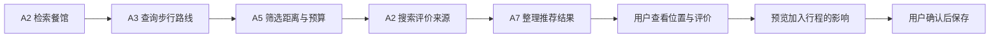

# TripFlow · 多 Agent 智能出行助手

把“想去哪里、想做什么”变成可检查、可修改的旅行行程，并在出行过程中提供地点讲解、任务提醒和附近美食推荐。

TripFlow 使用 React / TypeScript 构建界面，FastAPI 提供业务接口，通过总调度器与 7 个专业 Agent 协作完成需求理解、地点研究、路线查询、行程编排和约束核验。支持浏览器使用，也支持将页面与 Python 后端一起封装到 Android 手机内运行。

**当前 Android 版本：1.0.2（versionCode 3）** · 更新日期：2026-10-17

## 能做什么

- **聊天规划**：通过多轮对话补充或纠正城市、日期、人数、预算、交通方式和偏好，确认摘要后规划国内城市 1–3 天的行程。
- **地点自动匹配**：统一检查必去、避开、起点、终点、固定安排和任务地点；兼容括号、城市前缀及明确的公园简称。有歧义时在规划前确认，已有草稿也可自动补匹配。
- **真实地图与交通**：查询高德 POI、地址、照片及路线，比较允许的交通方式，显示服务返回的实际道路轨迹。
- **可预览的行程修改**：增加、删除、移动地点或调整停留时间后，先计算交通、时间和约束影响，预览并确认后再保存；支持撤销与重做。
- **到了再选餐馆**：围绕当前位置或行程地点，根据口味、半径、最长步行时间和人均参考预算推荐餐馆，显示具体分店位置、步行路线、高德评分与公开评价来源。
- **有来源的资料与内容**：查询营业时间、门票和预约资料；准备讲解、讲稿、拍摄清单等内容，并保留来源与未核验提示。
- **出行情境服务**：结合前台定位、到达与停留状态触发地点内容或任务提醒；Android 支持系统中文语音播报。

地图没有返回的路线、缺失的评价、未核实的票价和营业信息会明确标注，不用模拟数据填补。公开点评摘要可查看原文，不等同于平台完整评论列表。

## 应用内 Agent 分工

| 角色 | 职责 |
| --- | --- |
| 总调度器 | 路由请求、组织依赖、管理任务进度、失败与取消 |
| A1 需求理解 | 解析多轮对话、旅行条件与修改意图 |
| A2 地点与资料研究 | 检索、匹配真实 POI，核验地点并查询公开资料 |
| A3 交通研究 | 查询真实路线、出行时长与路程 |
| A4 行程规划 | 编排活动顺序、时间与候选修改方案 |
| A5 约束审核 | 检查时间、预算、锁定安排及距离等条件 |
| A6 主动服务 | 评估到达、停留等事件是否需要提醒 |
| A7 个性化内容 | 准备内容并整理带来源的展示结果 |

各 Agent 使用受限工具、结构化输入输出和真实进度事件。按任务组合规则计算、地图工具、搜索与模型调用，不会为每个步骤都调用一次大模型。

例如附近美食推荐的执行顺序：



## 本地运行

准备 Python 3.12、Node.js 22 和 PowerShell。以下命令均在仓库根目录执行。

### 1. 安装依赖

```powershell
git clone https://github.com/jlufyy/a02-Multi_agent_Collabration.git
cd a02-Multi_agent_Collabration

python -m venv .venv
.\.venv\Scripts\python.exe -m pip install -c apps/api/requirements-lock.txt -e './apps/api[test]'
npm ci --no-audit --no-fund
npm --prefix tripflow-frontend/tripflow ci --no-audit --no-fund
```

### 2. 配置服务

```powershell
Copy-Item .env.example .env
```

在本机 `.env` 中填写服务配置。仓库只提供空值模板，不包含可用密钥。

| 配置 | 用途 |
| --- | --- |
| `AMAP_WEB_SERVICE_KEY` 或 `AMAP_API_KEY` | 后端地点检索与交通路线 |
| `DEEPSEEK_API_KEY` | 需求理解和内容生成；也可按模板配置 AIPing 或其他供应商 |
| `DEEPSEEK_MODEL` | 指定模型；应使用账户实际可调用的型号 |
| `MODEL_ROUTES` | 可选，显式指定 A1 / A7 的供应商或模型路由 |
| `TENCENTCLOUD_WSA_APIKEY` | 腾讯云 WSA 联网资料搜索 |
| `TAVILY_API_KEY` / `BOCHA_API_KEY` | 可选的其他搜索服务 |
| `TRIPFLOW_SEARCH_PROVIDER` | 配置多个搜索服务时，选择 `tencent_wsa`、`tavily` 或 `bocha` |

配置 DeepSeek 后，默认用于 A1 和 A7；显式 `MODEL_ROUTES` 优先。模型服务和联网搜索是独立配置，只有模型 Key 不代表已启用搜索。更多选项见 [.env.example](.env.example)。

网页底图需要**独立的高德 JS API Key**。可复制前端模板后填写：

```powershell
Copy-Item tripflow-frontend/tripflow/apps/web/.env.example tripflow-frontend/tripflow/apps/web/.env.local
```

```dotenv
VITE_AMAP_KEY=你的高德JS公开Key
VITE_AMAP_SERVICE_HOST=你的高德安全代理地址
```

未使用安全代理时，可按账户配置方式填写 `VITE_AMAP_SECURITY_CODE`。同源运行时 `VITE_API_BASE_URL` 留空。也支持在根目录 `.env` 中配置这三项 `VITE_AMAP_*`；修改后需重新构建。

后端地图、模型和搜索密钥不能填入 `VITE_*`。没有配置 JS Key 时页面会提示地图未配置。

### 3. 启动

```powershell
.\start-tripflow.ps1
# 或 npm start
```

脚本构建前端后启动同源服务：

- 应用：<http://127.0.0.1:8010/>
- 接口文档：<http://127.0.0.1:8010/docs>

Ctrl+C 停止。已有构建且源码未变化时可用 `-SkipBuild`；端口冲突时可用 `-Port 8012`。

开发模式：

```powershell
.\start-tripflow.ps1 -Dev -Port 8011
```

浏览器访问 `http://127.0.0.1:5173`，Vite 自动代理到所选后端端口。

## Android 构建与安装

Android 使用原生 WebView 加载 React 页面，通过 Chaquopy 在手机内启动原 FastAPI 后端，固定应用地址为 `http://127.0.0.1:18761`。

**正常使用无需电脑、USB 隧道或桌面后端。** 地图、模型与搜索服务仍需联网。

| 项目 | 当前配置 |
| --- | --- |
| 包名 | `cn.tripflow.app` |
| 版本 | `1.0.2` / `3` |
| 架构 | ARM64 |
| 最低系统 | Android 8.0 / API 26 |
| 编译与目标 SDK | 35 |
| 原生能力 | 前台定位授权、中文 TTS、返回键与键盘/系统边距处理 |

本地构建还需要 JDK 17、Android SDK 35 和对应 Build Tools：

```powershell
.\android\build-android.ps1 -Variant Release
```

脚本读取本地 ENV，生成私人运行包与个人签名，执行检查并输出：

```text
output/android/TripFlow-1.0.2-personal-release-arm64.apk
```

覆盖安装并启动：

```powershell
adb devices -l
adb -s <设备序列号> install --no-streaming -r output/android/TripFlow-1.0.2-personal-release-arm64.apk
adb -s <设备序列号> shell am start -W -n cn.tripflow.app/.MainActivity
```

保留本机 `android/.local/` 中的签名文件，后续使用同一签名更新。`install -r` 保留应用数据。

私人 APK 包含构建时配置，不随公开源码分发；ENV、签名、APK、手机数据和生成资源均排除在 Git 外。详细构建、原生依赖与设备检查见 [Android 说明](android/README.md)。

## 数据与运行边界

- **行程保存在本地 IndexedDB**，后端没有云端行程主库。浏览器、完整域名及端口不同，看到的行程也不同。
- 正式修改遵循“提出方案 → 核验 → 预览 → 用户确认 → 本地原子保存”。任务成功不等于方案一定可保存，最终依据 `validation.committable`。
- 后端任务、幂等记录与预算控制为进程内状态，部署时使用单 worker。服务重启后进行中的任务不会继续。
- 定位服务面向前台使用，未添加 Android 后台 GPS 服务。户外实际到达、停留触发与长时间使用仍需实地验证。
- 当前完成 Android 真机安装、启动和相关真实接口验证；Docker 配置文件不代表已完成容器或公网部署验收。

## 开发检查

```powershell
# 后端与地点匹配回归
.\.venv\Scripts\python.exe -m pytest -q -c apps/api/pyproject.toml apps/api/tests

# 上下文引擎、前端与契约
node --test packages/context-engine/test.mjs
npm run test:web
npm run typecheck
npm --prefix tripflow-frontend/tripflow/apps/web run lint
npm run build
.\.venv\Scripts\python.exe packages/contracts/generate.py --app-openapi --check
```

1.0.2 的地点匹配修复已通过 10 项相关后端回归、48 项前端测试及手机接口冒烟测试。测试夹具明确标注为合成数据，不作为真实用户评价或户外定位证据。

## 目录与文档

```text
apps/api/                       FastAPI、Agent 工作流、供应商适配与测试
tripflow-frontend/tripflow/      React 前端及前端契约适配
packages/contracts/             共享契约与生成产物
packages/context-engine/        情境、定位与提醒状态逻辑
android/                        Android 容器、构建脚本与原生依赖
docs/                           架构、运行说明与历史验证记录
```

- [Android 构建说明](android/README.md)
- [架构说明](docs/architecture.md)
- [运行手册](docs/runbook.md)
- [供应商配置](docs/providers.md)
- [Android 1.0.1 真机交付记录（历史）](docs/TripFlow_Android_真机交付_2026-10-17.md)
- [应用修复记录](docs/TripFlow_修复与验证_2026-10-17.md)
- [规划体验优化记录](docs/TripFlow_体验优化_2026-10-17.md)

历史报告对应各自记录时的版本与测试条件，当前功能以代码及本 README 为准。
