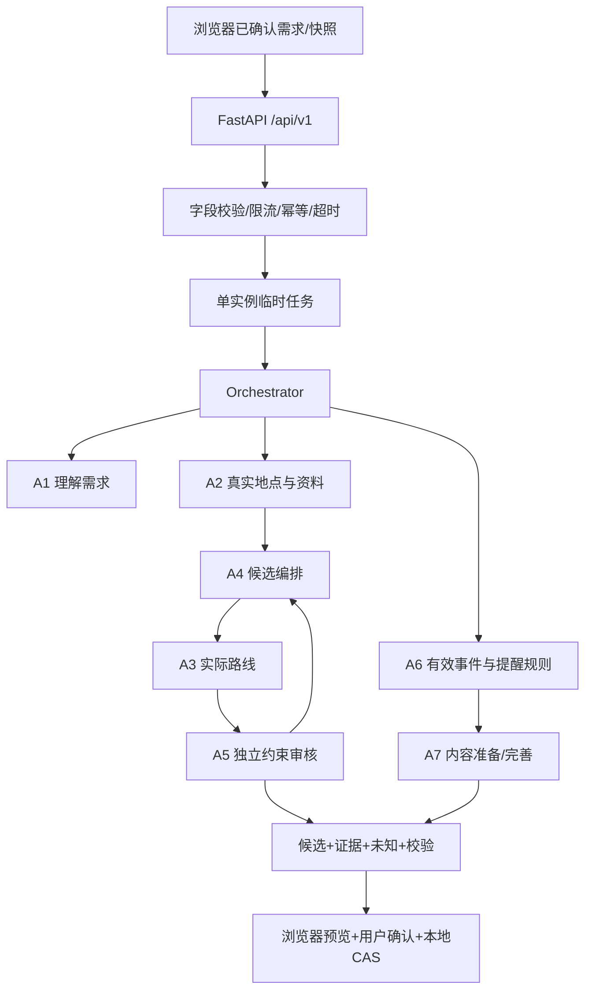

# 架构与前端交接

## 权威和执行边界

浏览器持有正式计划和事实日志；API 接收请求快照，不保存行程主库。`JobManager` 只暂存任务结果，重启后查旧任务返回 `JOB_NOT_FOUND`。后端只能校验请求里的版本一致性，不能知道请求发送后浏览器是否又编辑了计划。

采用显式有界工作流，而不是额外引入微服务或消息队列。A4/A5/A6 使用独立确定性策略上下文；它们并非虚构的 LLM 调用。A1/A7 调用配置模型，A2/A3 调真实工具。每个节点以 `AgentRunner` 约束工具名并校验输出类型，记录 agent/run/input_hash/output_schema/trace/tool_calls。外部文本不具备工具执行权限。

## 文件职责

- `schemas.py`：Pydantic 单一契约源，camelCase、严格类型、跨字段校验。
- `main.py` / `middleware.py` / `jobs.py`：14 个 HTTP 方法、统一信封、输入边界、临时任务。
- `workflows.py` / `agents.py`：三条流程、专业节点与实际工具事件。
- `planning.py` / `validation.py`：确定性副本编辑、排程、变化摘要、硬软约束。
- `providers.py` / `gateway.py` / `knowledge.py`：地图、模型、可匹配知识资料。
- `proactive.py` / `packages/context-engine`：服务端提醒候选、浏览器定位算法和显示前复核。

## 状态、事实与未知

路线 `evidence.status=VERIFIED` 表示从供应商取到了完整时长/距离估计，**不等于实测旅途时间**。若供应商不同 polyline 之间存在缺口，`routeGeometry` 被省略并列入 `ROUTE_GEOMETRY_UNKNOWN`；不会插入直线。时长仍可参与排程。零费用只有明确来源时才允许；未知票价、住宿和城际费用不补零。

新增、替换、最终复核、内容生成都会重新查询地点身份；I06 还会重放声明的 operations，防止候选夹带未声明变更。缓存默认为关闭；启用需要明确配置及适用许可。事实刷新若影响预览，I06 不偷偷改计划，要求重新 propose。

候选 revision 保持 baseRevision；首次生成候选为 0，由客户端首次落地为 1。规划输入与顶层冗余字段必须一致。锁定冲突返回一个保留原候选的 INFEASIBLE 提案，不能部分执行。

## 定位与主动服务

GeoPolicy 初始值为到达 250 m、离开 375 m、最大精度误差 100 m、到达驻留 90 s、离开驻留 120 s、至少 3 样本、最大速度 70 m/s、最大样本间隔 120 s；这些是可调实验初值，不是实测最佳值。

原始 GPS 留在浏览器。仅有效事件发给 A6，附当前快照、arrivalId、精度和近期通知事实。后端检查模式/活动投影/到达上下文/去重；它不能远程证明浏览器真的跑过算法，也不会伪造权限或定位证据。前端必须保存状态机 diagnostics，显示前再次 filterNotifications。

L3 真实风险需要在确定性验证中重现对应冲突；模拟风险必须显式 DEMO 命名空间。风险只提供调整入口，绝不自动改计划。L2 依赖已确认地点任务，L1 依赖知识/周边意图；无价值事件不会调用模型。`shownAt` 由实际 UI 显示后写入，不由服务端返回卡片时写入。

## 模型与资料边界

模型只得到当前工作所需的结构化上下文，不能调用任意工具。结构失败最多修复一次，包含错误路径和前次结果；仍失败保持可见错误。普通讲解从 I05 返回 CONTENT；没有选中地点则 CLARIFICATION。自然语言不能擅自解锁或提高预算，需表单明确操作。

知识参考使用同名、坐标接近的百科条目；引用注明获取时间、许可和非官方性质。资料不可达时只允许创作/观察辅助，历史知识或管理政策明确未知。不要把百科或 POI 搜索作为现场拍摄许可证明。

官方参考：[FastAPI lifespan](https://fastapi.tiangolo.com/advanced/events/)、[MediaWiki TextExtracts](https://www.mediawiki.org/wiki/Extension:TextExtracts)、[AIPing 文本接口](https://aiping.cn/docs/API/text-models)。
