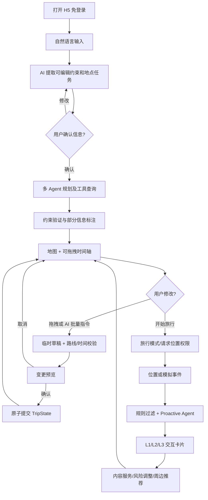
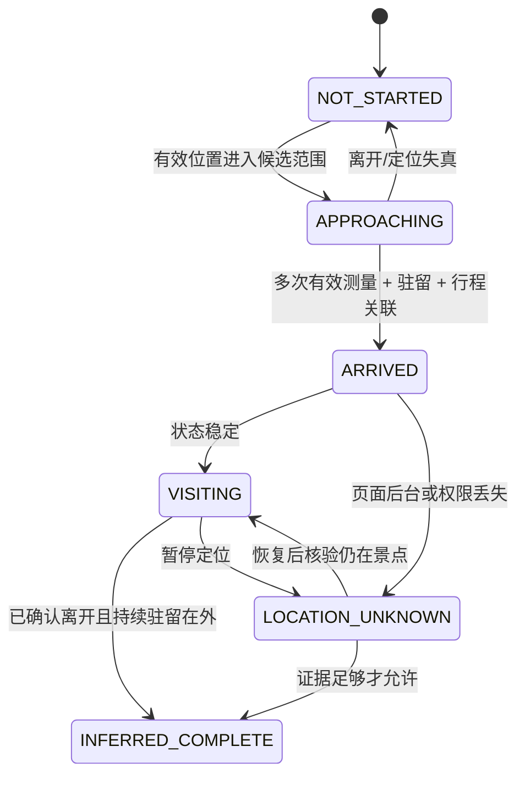

# 多 Agent 情境感知智能旅行助手 — 产品需求文档（PRD）

> **项目代号**：TripFlow（暂定，不代表最终品牌）  
> **所属项目**：莱森购 AI 黑客松 · 多 Agent 赛道  
> **文档版本**：v1.0（研发基线稿）  
> **编写日期**：2026-10-16  
> **状态**：需求边界已根据 29 轮讨论确定；尚未开发、部署或测试  
> **目标读者**：2–3 人开发团队、UI/前端、Agent/后端、测试及路演评审  
> **交付物**：免登录、手机浏览器可用的 H5 Web App；附源码、可运行部署地址、测试记录与路演脚本  
>
> **最重要的约束**：下文所有来自用户已确认选择的功能，均纳入比赛交付和验收范围；不得因为称为“Demo”就擅自删成无功能页面。可简化内部实现深度，不可做假按钮、预录制 Agent 流程、把模拟数据冒充真实数据。实现与通过测试属于开发目标，**不代表当前已经具备**。比赛前剩余工时极有限，必须同步记录完成状态和风险，不能以 PRD 代替实测。

---

## 0. 执行摘要

### 0.1 一句话定位

面向国内 1–3 天城市自由行用户的多 Agent 智能旅行助手：**出发前可靠规划、途中灵活修改、到达地点后主动兑现用户先前表达的旅行意图**。

### 0.2 用户价值与核心差异

1. **从“攻略”到“可操作的行程”**：自然语言生成可编辑时间轴与真实地图路线，结合地点、时间、交通和预算进行约束核验。
2. **人机共同编排**：可用手指调整景点顺序，也可一次性用自然语言批量修改；先预览影响，用户确认后才生效，支持撤销/重做。
3. **意图驱动的主动服务**：用户此前表达“到天坛想听建筑讲解”或“到天安门想拍演讲视频”，在相关地点到达后，Agent 结合上下文主动触发有价值的分级交互卡片。
4. **7 个职责明确的 Agent 真正协作**：工作流共享同一份 `TripState`，以可核验的工具调用、结构化输出和真实任务进度证明多 Agent 价值。
5. **实用与科研兼顾**：评测规划约束满足、事实可靠性、局部修改一致性、主动提醒准确率/打扰率、成本和时延；不宣称“多 Agent 天然比单 Agent 更强”。

### 0.3 目标用户、场景和非目标

- **目标用户**：国内 1–3 天城市自由行的学生、年轻个人用户、情侣、朋友小团体；由一名用户统一编辑，可录入同行者人数和偏好。
- **重点演示城市**：北京两日游（天坛知识讲解、天安门拍摄/演讲意图）；**不得把地点和流程写死**，应可以更换国内城市并调用真实地点服务。
- **首版运行平台**：移动浏览器 H5；无需注册登录；同设备本地保存多份行程。
- **不在交付范围**：账号注册和验证、跨设备同步、多人实时共同编辑、酒店/机票交易与支付、逐步导航/实时语音导航、H5 后台持续定位保证、复杂历史版本树、多人同时在线冲突合并。
- **范围澄清**：不做导航 **不等于** 不做位置感知；当前设备开启旅行模式后，网页前台仍自动识别有效到达/离开并触发主动服务。

### 0.4 不能妥协的质量门槛

- 地图、时间轴、特殊意图和提醒计划引用**同一已确认行程状态**。
- 真实数据与模拟事件必须可区分；不允许虚构票价、开放时间、交通耗时或 GPS 位置。
- 用户修改行程时，全部操作先基于副本计算、检查、预览，再一次性提交；不可出现部分修改已经生效。
- L3 风险必须有规则或数据证据；内容 Agent 不能自己编造“官方拍摄点位允许拍摄”等未经核实的事实。
- 每个 Agent 都有可验证的职责、输入输出、工具权限和执行记录；进度由实际执行事件驱动。
- 位置使用经用户授权、可暂停；自动推定完成必须支持纠错。

---

## 1. 决策台账：29 项已确认需求（禁止丢失）

| 编号 | 已确认决策 | PRD 对应模块 | 验收关联 |
|---|---|---|---|
| D01 | 手机响应式 Web App / H5 | §4、§11 | AC-01 |
| D02 | 规划 → 执行 → 主动服务完整链路 | §3、§5 | AC-02 |
| D03 | 国内城市 1–3 天自由行 | §2、§5 | AC-03 |
| D04 | 位置 + 行程 + 历史意图联合触发 | §6 | AC-09 |
| D05 | L1 轻提示、L2 交互任务卡、L3 风险提醒 | §6 | AC-10 |
| D06 | 自然语言输入 + AI 提取 + 可编辑结构化表单 | §5.1、§7 | AC-04 |
| D07 | 地图 + 自由拖拽时间轴双向联动 | §4.2、§5.3 | AC-05 |
| D08 | 拖动后智能预览、冲突检查、用户确认 | §5.4、§7 | AC-06 |
| D09 | 简洁的真实 Agent 工作进度 | §4.5、§8 | AC-12 |
| D10 | 完整型 6–8 专业 Agent | §8（7 个） | AC-13 |
| D11 | 提前准备 + 到达后实时生成 | §6.5、§8 | AC-11 |
| D12 | 核心真实 API + 清晰标注的演示数据 | §9 | AC-14 |
| D13 | 多供应商兼容 + 按 Agent/任务分配模型 | §8.4、§10 | AC-15 |
| D14 | 模块化主动服务：知识、任务、风险、周边推荐 | §6.4 | AC-16 |
| D15 | 当前不设任何账号/登录/验证 | §7、§10 | AC-17 |
| D16 | 支持多人出行、单人统一规划 | §5.1 | AC-18 |
| D17 | 2–3 人小团队 | §12 | AC-19 |
| D18 | 现有代码基础为零 | §12 | AC-19 |
| D19 | 用户确认允许赛前开发、现场继续完善 | §12、§14 | AC-19 |
| D20 | 高级极简 + 灵动智能交互 | §4.1 | AC-20 |
| D21 | 地图底层 + 三档 Bottom Sheet 时间轴 | §4.2 | AC-05 |
| D22 | 规划/旅行双模式 + 启动建议；用户控制定位 | §4.3、§5.5 | AC-07 |
| D23 | 到达和离开均自动感知，自动推定完成 | §6.2 | AC-08 |
| D24 | 全局悬浮 AI + 当前景点/卡片/模式上下文 | §4.4、§5.6 | AC-21 |
| D25 | 一次指令支持增删替换移动和条件化批量修改 | §5.6、§7.4 | AC-22 |
| D26 | 简单撤销/重做，无复杂历史版本 UI | §5.7、§7.3 | AC-23 |
| D27 | 地图真实路线展示；不内置导航 | §5.3、§9 | AC-24 |
| D28 | 智能适度提醒、去重、冷却、暂停 | §6.3 | AC-25 |
| D29 | 免费 HTTPS：Netlify + Render；Cloudflare Tunnel 备用 | §11 | AC-26 |

**解释优先级**：如早期讨论中曾建议把某核心模块延期，后续用户明确要求“之前选择的核心功能比赛都要真能使用”，以该较晚要求为准。本 PRD 因此为「周边推荐」保留可实际使用的最小闭环；仅将推荐算法的高阶增强列为赛后研究。

---

## 2. 用户角色、需求和典型任务

### 2.1 角色

- **旅程创建者（唯一操作者）**：输入自由语言、录入同行人数和偏好、确认/修改/撤销行程、切换旅行模式、授权定位。
- **同行者（数据角色，不是登录用户）**：可被创建者记录个人兴趣、预算、步行接受度与特殊需求；无独立登录和编辑入口。
- **评委/体验者**：扫码进入 H5、浏览真实计划，在明确标记的演示模式下注入位置/风险事件，观察同一套 Agent 和状态机产生的结果。

### 2.2 JTBD

1. 我想把零散的城市旅行想法迅速变为有时间、真实地点和路线的行程。
2. 我想调整景点顺序，快速知道是否冲突，不希望重新写一篇完整攻略。
3. 我希望 App 记得我在某个地点要做的事情，到达后自动帮助我。
4. 我和朋友偏好不同，希望在同一份行程里兼顾大家，但不需要各自注册。
5. 我希望在真实位置不准确、网络不好、模型失败时知道系统究竟查到了什么、什么还不确定。

### 2.3 主演示故事

**测试行程**：两人去北京玩 2 天，喜欢历史文化和拍照，想参观天坛，在天安门附近拍摄一段具有纪念意义的演讲视频，预算有限；交通方式以公共交通/步行为主。

用户输入 → AI 提取确认表单与任务意图 → 七 Agent 按需要参与规划 → 地图+时间轴 → 拖拽改变游览顺序 → 预览交通/时间影响 → 确认 → 切换旅行模式 → 模拟移动到天坛（L1）→ 模拟到天安门（L2，读取此前任务并实时完善稿件）→ 模拟可信时间冲突（L3）→ AI 批量调整行程 → 撤销/重做 → 正常保留计划。

**重要**：天安门及其周边对进入、摄影摄像、特定活动等可能有现场管理规定；系统只提供一般拍摄准备和文案辅助，拍摄位置及规则必须核实官方最新信息，不能承诺特定区域一定允许拍摄。

---

## 3. 产品业务状态与端到端流程

### 3.1 业务主流程



### 3.2 生命周期与模式

- **计划状态**：`DRAFT_INPUT` → `PLANNING` → `PLAN_READY` → `TRAVELING` → `TRIP_ENDED`。
- **规划模式**：不会自动开启持续定位；可编辑、删除、增加地点、创建意图、预览调整。
- **旅行模式**：明确由用户启动，获取位置授权后进行前台位置监听；突出当前位置、下一站、当前活动与提醒；仍允许编辑行程。
- **启动建议**：旅行日期临近且用户主动打开该行程时，可显示“开启旅行模式？”；**不可静默开启定位**。
- **退出旅行模式**：调用 `clearWatch` 停止位置监听；保存当前行程和事件记录。
- **H5 限制**：后台、锁屏后定位更新不可靠；回到前台重新测量，不推断缺失区间的完整轨迹。

---

## 4. 信息架构与 UI/UX 设计规范

### 4.1 视觉语言

- **设计方向**：Apple 式简洁留白 + 温和渐变 + 精致圆角与浅阴影 + 流畅弹性动效。不是重霓虹或复杂 Agent 驾驶舱。
- **建议色板**（最终按视觉测试调整）：背景 `#F8FAFC`，卡片 `#FFFFFF`，主色 `#438AF5`，辅蓝 `#99B9F8`，正文 `#192537`，警示 `#D97706`，危险 `#DC2626`，成功 `#16A34A`。
- **圆角**：主要卡片 16–20px；底部抽屉 24px 起；按钮 12–16px。
- **字号**：页面标题 22–28px、卡片标题 15–18px、正文 14–16px、辅助信息 12–13px，保持可访问性和对比度。
- **动效建议**：180–320ms；优先 `transform/opacity`；手势触发时不等待模型；支持 `prefers-reduced-motion`。
- **触摸目标**：重要操作至少约 44×44 CSS px，拖动手柄具备明确命中区。
- **地图底图来源**：真实地图 SDK，而不是静态图片伪装交互。

### 4.2 地图 + 底部抽屉：三个显示档位

```text
┌─────────────────────────────┐
│ 北京 · 第 1 天    模式开关  │
│                             │
│        可交互真实地图       │
│    ① → ② → ③ 路线与标记   │
│                             │
│ [当前位置]       [AI ✨]   │
│ ╭─────────────────────────╮ │
│ │ ─── 抽屉拖动手柄 ───    │ │
│ │ 第 1 天 预计交通 58 分钟 │ │
│ │ ≡ 09:00  天坛           │ │
│ │ ≡ 12:00  午餐           │ │
│ │ ≡ 14:00  天安门         │ │
│ ╰─────────────────────────╯ │
└─────────────────────────────┘
```

| 抽屉状态 | 高度初值 | 主要用途 |
|---|---:|---|
| 收起 | 约 20% 可用屏高 | 看地图与当前下一站摘要 |
| 半展开（默认） | 约 55% | 地图与时间轴同屏浏览 |
| 全展开 | 约 85% | 拖拽排序、批量编辑与详情 |

- **抽屉手势**：只从顶部专用手柄拖动改变高度。
- **卡片手势**：在右侧专用拖动手柄长按/拖动，仅作用于行程排序；不能误拖抽屉。
- **正常纵向滑动**：时间轴区域内部滚动；和地图缩放/平移不互相抢事件。
- **双向联动**：选中活动→地图 `panTo` 对应 POI 并高亮；选中地图 Marker→滚动对应卡片并高亮。
- **路线与活动顺序**：正式已确认路线用实线；修改预览可用不同样式标记，未查询到路线时明确显示“路线待核验”，不可用直线冒充道路导航路径。
- **同屏冲突**：打开 AI 浮层或变更确认面板时，避免底部抽屉与浮层叠加抢焦点；优先关闭/压缩一个面板。

### 4.3 页面清单

| 页面 ID | 页面 | 必须元素/操作 |
|---|---|---|
| P01 | 首页/我的行程 | 新建旅行、进入已存计划、演示模式说明，无登录 |
| P02 | AI 需求输入 | 自然语言文本、例子提示、正在解析状态、失败重试 |
| P03 | 需求确认 | 城市/日期/人数/预算/交通方式、每人偏好、必去地点、锁定条件、地点任务卡；全部可编辑 |
| P04 | 规划中 | 真实 Agent 进度、取消/错误/重试、工具数据异常提示 |
| P05 | 规划地图主页 | 真实地图、路线、日切换、底部时间轴三档、撤销/重做、全局 AI |
| P06 | 活动详情 | 地点来源、经纬度/地址、活动时长、交通、费用/未知说明、绑定意图、锁定开关 |
| P07 | 变更预览 | 原/新行程对比、交通与时间影响、硬约束错误、确认与取消 |
| P08 | 旅行模式 | 当前定位/状态、下一站、活动进度、退出模式、模拟模式入口（显式标注） |
| P09 | 主动服务卡片 | L1/L2/L3 层级、查看内容/忽略/稍后/处理风险 |
| P10 | 全局 AI 面板 | 当前选中上下文、自然语言批量修改、快捷动作、真实 Agent 进度 |
| P11 | 偏好与提醒设置 | L1/L2 暂停、风险提醒开关、定位授权说明、清除本地行程/模拟记录 |
| P12 | 演示控制台（开发/评委） | 显式演示水印、地点轨迹/时间事件注入、重置演示状态、真实 Agent 执行记录摘要 |

### 4.4 全局悬浮 AI

- 在地图、时间轴、活动详情、旅行模式都可以打开。
- 自动附带 `trip_id`、`plan_revision`、`mode`、`selected_activity_id`、`selected_poi_id`、`active_day`；不靠猜测聊天文字来寻找当前地点。
- 快捷操作随场景变化，例如“修改此站”“调整今天下午”“讲解这里”“附近美食”。按钮必须真实触发对应工作流。
- 自然语言若涉及行程更改，始终进入「修改预览 → 用户确认」；内容讲解等非修改操作可直接显示结果。
- 模型运行超时/断开时可关闭 AI 面板，不影响已保存行程。

### 4.5 Agent 进度展示

- 只显示简短、真实的业务步骤：“理解需求中”“正在检索景点”“正在计算交通”“正在校验行程”“内容准备完成”。
- 来源必须是后端真实事件 `agent_started/agent_completed/tool_call_started/tool_call_finished/agent_failed`，不能用纯定时动画假装完成。
- 出错时明确是哪个环节及是否能够重试；用户无需看到内部提示词或复杂拓扑。

---
## 5. 详细功能需求

### 5.1 FR-01：自然语言输入与可编辑信息抽取（P0）

**用户输入**：自由文本描述目的地、日期、到达/返程时间、交通方式、预算、偏好、同行者特殊需求、想完成的具体任务。

**解析流程**：
1. 意图理解 Agent 输出结构化旅行要求及 `missing_fields`、`uncertain_fields`。
2. 前端显示可编辑表单：目的地、日期（1–3 天）、人数、总/人均预算及是否包括住宿大交通、起止点、必须去/不想去、兴趣、体力/步行偏好、同行偏好、目标地点关联特殊任务。
3. 用户修改、确认后，生成一个**确定的需求版本**交由规划工作流处理；不把尚未确认的模型抽取当作事实。
4. 非必填字段允许默认值或“未指定”，关键字段缺失时按最少问题引导补齐。
5. 提取“在天安门录制演讲视频”应生成关联 `place_query` + `intent_type=VIDEO_SHOOT` + `desired_output`，POI 匹配后才能设置明确目标地点；位置匹配不确定时要求用户选择对应地点。

**人数**：支持 1—若干人并由创建者统一管理偏好；不提供邀请/在线共同编辑功能。

**验收**：一段含预算、两天、两个景点、两种不同偏好和一个拍摄任务的中文描述，提取后能编辑每一项；点击确认后这些信息确实影响生成行程及主动提醒配置。

### 5.2 FR-02：多 Agent 行程规划（P0）

**输入**：用户确认后的 `TripRequirements`。  
**输出**：1–3 天 `ItineraryDay[]`，每站包含真实 POI、开始与结束时间、持续时长、交通方式/已查询路线、费用属性、预订或锁定状态、来源以及关联意图。

1. 搜索候选地点时先执行去重和 POI 匹配，记录 `source_provider`、`source_id`、坐标与获取时间。
2. 提前筛选明显不适合的地点；营业时间、票价、排队时长缺失时明确“待核验”。
3. 根据交通时间、开放时间和用户约束生成候选活动顺序；算法与规则层检查：日内时间窗口、起止点、固定集合活动、已锁定活动、预算上限、相邻活动间移动耗时。
4. 结果标识 `verified / estimated / unknown`，其中“候选景点真实存在”**不代表**该活动的当前营业时间或门票已核实。
5. 出现硬约束无解时报告冲突原因并建议放宽条件，不制造不可能的方案。
6. 结果通过地图/时间轴展示，不能只是文字攻略。

**最小合格能力**：在任意已支持的国内城市完成真实 POI 搜索和步行/公交等基本路线计算，输出可编辑且具来源状态的完整 1–3 天日程。若某地区 API 数据不足，应如实提示能力受限。

### 5.3 FR-03：地图、路线和可拖动时间轴（P0）

1. 全屏地图 + 三档 Bottom Sheet，包含景点编号、日切换、起止点、线路线段和每站交通概要。
2. 时间轴每张卡片显示开始时间、地点名称、游览时长、花费状态、意图/风险标识，支持选中、详情与专用手柄拖动。
3. 地图与卡片双向选中联动。
4. 拖拽后展示临时顺序；用地图路线服务重新查询相邻路线，必要时更新下游活动时间；不允许“只是视觉换位”。
5. 提供 `loading / verified / unknown / failed` 视觉状态，地图无法加载时保留时间轴并提示“地图不可用”；地图路线不能拿两 POI 的直线代替真实道路而不标注。
6. **仅做路线展示**：不提供 turn-by-turn 指令、实时导航语音、路口提示、偏航路线动态引导、外部导航 App 专用一键启动。

### 5.4 FR-04：拖拽后的智能预览与确认（P0）

- 拖动卡片/改时间产生 `proposed_operations`，操作仍在草稿，不覆盖正式 `TripState`。
- 后端根据当前修订号和可验证数据计算候选方案，并报告新增/移除/换序、活动时间差、交通总耗时差、费用差以及硬约束结果。
- 对无法核验的费用/营业时间显示“不确定”，不显示捏造的具体差价。
- 用户点击**确认应用**时一次性提交候选结果并更新活动顺序、地图路线、意图关联、提醒调度；用户取消时恢复原状态。
- 若正式状态已经变化（例如旧预览尚未确认时又编辑），拒绝旧预览并提示重新计算，防止覆盖更新。
- 对无法满足硬约束的草稿禁用直接提交，必须改变条件/重新规划；仍应显示冲突原因。

### 5.5 FR-05：规划/旅行双模式（P0）

- **规划模式**：内容为地图、可编辑日程、候选地点、任务意图、修改和预算信息。
- **旅行模式**：在同一张地图突出当前位置、当前活动与下一站，展示活动状态与 ProactiveCard；保留拖拽、批量修改与日程查看。
- 临近旅行日期打开计划时，可提示进入旅行模式；**用户决定是否进入，定位另行授权**。
- 用户退出旅行模式后停止监听；演示模式仍以显式模拟来源运行，和真实位置分开。
- 位置不可用时允许用户查看/编辑行程及切换演示测试，**不得声称已自动抵达**。

### 5.6 FR-06：全局 AI 与自然语言批量修改（P0）

支持操作语义：`ADD_ACTIVITY / REMOVE_ACTIVITY / REPLACE_ACTIVITY / MOVE_ACTIVITY / UPDATE_TIME / UPDATE_DURATION / UPDATE_CONSTRAINT`。一个用户请求可以包含多项操作及全局条件。例如：

> “明天下午不想走太多路，删掉景山，换成附近咖啡馆，预算不能增加，天安门拍摄任务不许动。”

解析时先区分“必须满足的硬条件”和“尽量满足的偏好”，并绑定稳定的 activity ID；一个不明确的地名不得静默指向错误景点。

**执行要求**：批量操作作为一次**原子候选变更**处理，先创建建议方案、校验再确认。遇到部分操作无法满足，整体保持未提交状态并给出阻碍原因。一次确认后，整体对应一次撤销。

**多轮边界**：支持普通上下文连续对话与追问信息；本轮已确定的是批量修改 **B**，不是自动增加“多轮草稿反复调优 + 完整历史版本 UI”。如果用户提出新修改请求，可以根据当前正式行程另起候选草稿；保留正常对话上下文即可。

### 5.7 FR-07：撤销 / 重做（P0）

- 用户确认的每次行程修改，生成一个完整快照或确定性的可逆操作，进入 Undo 栈；Redo 栈在新提交后清空。
- `Undo` 恢复上一个已确认计划，`Redo` 恢复被撤销的已确认计划；路线与时间轴一致恢复。
- 批量修改的一整批作为一次原子历史单元；不得只恢复其中一部分。
- 保存意图、锁定状态和**计划中的**提醒配置；到达事件和已显示提醒属于事实日志，不随撤销被伪造删除，避免重复触发。
- 可在客户端保存最近约 10–20 次操作（容量建议，非已验证最佳值），并持久化到本地；不开发历史版本列表、方案树或在线协同历史。
- 恢复行程后的异步 Agent 结果必须检查修订号，过期输出不得提交。

### 5.8 FR-08：附近推荐（P0，模块化最小可用闭环）

- 在旅行模式的选中地点、当前定位或明确指定的地理区域调用真实 POI 搜索，筛选美食/休息/拍照类候选。
- 结合偏好、剩余行程时间和预算给出有来源的 2–5 个候选；名称、地点、距离属性和相关性解释不能凭空编造。
- 用户可以查看地点详情、添加至行程；**添加行为必须进入修改预览与确认**。
- 推荐无法查询、评分不可用或营业状态未知时分别提示；不把 AI 自身估计标作地图服务返回的评价。
- 不要求首版实现用户长期点击反馈训练、多站点协同交易和复杂实时拥挤度计算。

---

## 6. Proactive Intelligence Engine（主动情境智能引擎）

### 6.1 设计目标

核心差异不是“进入地理围栏就播放景点百科”，而是识别**用户此行打算在特定位置完成什么目标**，结合当前时间和真实进度选择服务内容、优先级与触发时机。

**依赖条件**：用户同意定位（真实模式）、存在已确认行程、事件匹配当前/即将进行活动，且经过去重和防打扰检查。来自演示模式的事件必须携带 `source=SIMULATED`。

### 6.2 自动到达 / 离开状态机（FR-23）



**工程规则（初始可调参数，不是现实世界精度承诺）**：

| 参数 | 初值建议 | 注意事项 |
|---|---:|---|
| POI 到达半径 | 200–350 m，允许按地点类型配置 | 大景区不能简单以中心点半径代表真实入口 |
| 离开半径 | 到达半径 + 100–150 m | 双阈值形成滞回，减少围栏边缘抖动 |
| 有效定位精度 | `accuracy <= 100m` 优先 | 不达标时标记未知；可根据设备调整 |
| 到达驻留 | 连续有效位置覆盖约 60–120s | 防止坐车短暂经过即触发 |
| 离开驻留 | 连续在离开范围外约 120s | 不能一次跳点就推定完成 |
| 行程匹配 | 当前站/即将开始站优先 | 偏离计划时不要静默完成无关活动 |
| 页面不可见 | 暂停推断 | 不根据后台缺失的数据补写虚构轨迹 |

定位判定还应考虑 `timestamp`、精度、速度突变、重复采样、候选 POI 之间的重叠围栏、多日重访。**到达**可自动触发主动提醒；**推定完成**只意味着有足够离开证据，不能证明用户已经参观过。允许用户纠正错误推断，但不依赖每站手动签到或手动点完成。

**真实 H5 技术事实**：`navigator.geolocation.watchPosition` 需要 HTTPS 与显式授权；当网页后台/不可见或锁屏时，持续更新不能保证。返回前台通过重新采样恢复，未知区间保持 `LOCATION_UNKNOWN`，不能承诺后台连续定位。

### 6.3 通知等级、防打扰与优先队列（FR-05/FR-28）

| 等级 | 触发例子 | UI | 基本规则 |
|---|---|---|---|
| L1 知识 | 抵达天坛且偏好建筑知识 | 不阻断的轻提示/小卡 | 每次有效到达最多 1 个；可忽略 |
| L2 任务 | 天安门抵达并命中已确认拍摄意图 | 交互卡：讲稿/拍摄清单/稍后 | 明确任务优先于 L1；同任务同次抵达默认提醒 1 次 |
| L3 风险 | 可信的固定集合时间冲突 | 醒目风险卡：证据/查看调整方案 | 可突破普通冷却时间，但同一风险不得刷屏 |

- 优先级：`L3 > L2 > L1`。同一时刻只展示一张主动卡片，其余进入队列；正在拖拽、确认草稿或查看输入表单时普通提醒暂缓。
- 初始普通提醒冷却期：约 15 分钟（可配置）；用户忽略后本次到达不再重复同一内容。
- 用户可暂停 L1/L2；L3 是否展示由单独开关决定，默认有可信风险才提示。
- 不使用模型自己生成的“95% 紧急概率”作为触发依据；硬限制由程序判定，Agent 决定候选内容与服务模块。
- 日志记录 `event_id / trip_revision / intent_id / decision / suppression_reason / shown_at / action_taken`，以解释为什么推送/为什么没有推送。

### 6.4 四个模块都需可调用

1. **知识模块 `KNOWLEDGE`**：匹配用户兴趣，提供景点建筑、历史、人文介绍；只有明确事实能引用，未知资料不装作官方准确记载。
2. **任务模块 `PERSONAL_GOAL`**：将用户已确认的“在某地拍照、录视频、准备演讲、打卡”等转成地点关联任务，抵达时先显示预准备内容，再根据用户要求实时完善。演讲稿可以作为原创写作输出，但拍摄位置和管理政策须核验。
3. **风险模块 `TRIP_RISK`**：基于可信的时间/交通约束（或明确标注的模拟延误事件）检查风险，展示发生原因和修改入口，**不能自动覆盖行程**。
4. **附近模块 `NEARBY`**：通过真实 POI 及偏好生成附近美食/休息/摄影候选，用户操作后可插入候选行程；不宣称未知商家的实时营业和排队情况。

**避免重复造 Agent**：四种服务模块调用既有研究、交通、规划、内容、审核 Agent 及真实工具；不是另外再新建四个独立 Agent。

### 6.5 行前预准备与行中实时生成（FR-11）

- **行前**：把明确的任务意图关联到 POI，并对高相关任务预生成摘要、讲稿提纲、拍摄清单；保存生成时间、内容版本、来源与适用范围。知识模块可准备简要说明。
- **行中**：到达后首先显示已预备的任务卡，打开时调用内容 Agent 根据当前位置、上下文和用户补充要求实时完善；需要实际天气/营业状态的信息必须重新查询或提示待核实。
- **失效**：地点被删除、日程改变、用户取消任务或模式变化时，重新计算提醒触发计划；过期内容要重新校验或标注。
- **成本控制**：不能在后台持续让大模型轮询 GPS；只有在规则检测到有价值事件或用户主动操作时才唤醒相关 Agent。

### 6.6 真实位置和演示事件共用同一算法

```text
RealLocationAdapter ─┐
                     ├→ NormalizedLocationEvent → GeoStateMachine → ProactiveDecision
SimLocationAdapter  ─┘                                 ├→ Agent/Tools
                                                       └→ L1/L2/L3 Card
```

演示模式以明显水印展示“模拟位置/事件”，通过逐步注入 `APPROACH / DWELL / ARRIVE / LEAVE / RISK` 等事件驱动**同一套状态机**。模拟结束可一键重置。演示测试与真实旅行记录隔离，不污染日常行程中的实际到达历史。

---
## 7. 共享状态、数据模型与编辑事务（前后端共同契约）

### 7.1 单一事实来源

**已确认计划的权威状态保存在当前设备的 `TripState`**，可采用 Zustand + IndexedDB（轻量演示可用 localStorage；数据体积过大再迁移）。免登录无跨设备一致性保证。前端每次调用后端时发送必要的已确认状态快照或其摘要；后端**不能把仅存在自身临时内存中的聊天内容当作唯一计划真相**。

结构分三层：

1. **计划真相 `TripState`**：城市、日期、人数与偏好、已确认活动、锁定项、历史意图和提醒规则。
2. **候选编辑 `RevisionProposal`**：`base_revision` + 操作集 + 计算后的候选行程 + 校验结果；用户确认前不更新计划真相。
3. **事实事件 `EventLog`**：定位检测、已展示提醒、任务执行记录、模拟来源等；与可撤销的计划分开保存，避免“撤销编辑”意外重复推送。

### 7.2 TypeScript 结构示例（开发契约草案）

```ts
type DataStatus = 'VERIFIED' | 'ESTIMATED' | 'UNKNOWN' | 'FAILED';
type EventSource = 'REAL' | 'SIMULATED' | 'USER_CORRECTION';
type TripMode = 'PLANNING' | 'TRAVELING';
type ActivityProgress =
  | 'NOT_STARTED' | 'APPROACHING' | 'ARRIVED'
  | 'VISITING' | 'INFERRED_COMPLETE' | 'LOCATION_UNKNOWN';
type IntentType = 'KNOWLEDGE' | 'PHOTO' | 'VIDEO_SHOOT'
  | 'SPEECH' | 'CHECK_IN' | 'FOOD' | 'OTHER';

type GeoPoint = { lat: number; lng: number; coordinateSystem: 'GCJ02' | 'WGS84' };
type Evidence = {
  provider: string;
  externalId?: string;
  fetchedAt?: string;       // ISO 8601
  status: DataStatus;
  sourceUrl?: string;
  note?: string;
};
type Place = {
  poiId: string;            // 内部稳定 ID
  name: string;
  address?: string;
  location: GeoPoint;
  evidence: Evidence[];
};
type TravelIntent = {
  id: string;
  activityId?: string;
  placeId?: string;
  placeQuery?: string;
  type: IntentType;
  userRequest: string;
  desiredOutputs: string[];
  confirmed: boolean;
  status: 'PENDING' | 'READY' | 'TRIGGERED' | 'CANCELLED';
  preparedContentIds: string[];
};
type TravelSegment = {
  fromActivityId: string;
  toActivityId: string;
  mode: 'WALK' | 'TRANSIT' | 'DRIVE';
  durationMin?: number;
  distanceMeters?: number;
  routeGeometry?: GeoPoint[];
  evidence: Evidence;
};
type ItineraryActivity = {
  id: string;
  place: Place;
  dayIndex: number;
  orderIndex: number;
  startAt: string;          // 城市所在时区的 ISO 时间
  endAt: string;
  estimatedCostCny?: number;
  costStatus: DataStatus;
  locked: boolean;
  mandatory: boolean;
  progress: ActivityProgress;
  intentIds: string[];
};
type CompanionPreference = {
  id: string; label: string;
  interests: string[];
  walkingTolerance?: 'LOW' | 'MEDIUM' | 'HIGH';
  personalBudgetCny?: number;
};
type TripState = {
  schemaVersion: 1;
  tripId: string;
  revision: number;
  title: string;
  destinationCity: string;
  startDate: string;
  endDate: string;
  travelerCount: number;
  budgetCny?: number;
  budgetScope?: 'PER_PERSON' | 'TOTAL';
  companions: CompanionPreference[];
  preferences: string[];
  mode: TripMode;
  activities: ItineraryActivity[];
  segments: TravelSegment[];
  intents: TravelIntent[];
  notificationPolicy: {
    enableL1: boolean; enableL2: boolean; enableL3: boolean;
    paused: boolean; cooldownMinutes: number;
  };
  updatedAt: string;
};

type EditOperation =
  | { type: 'ADD'; activity: ItineraryActivity }
  | { type: 'REMOVE'; activityId: string }
  | { type: 'REPLACE'; activityId: string; candidatePlaceId: string }
  | { type: 'MOVE'; activityId: string; dayIndex: number; orderIndex: number }
  | { type: 'UPDATE_TIME'; activityId: string; startAt: string }
  | { type: 'UPDATE_CONSTRAINT'; key: string; value: unknown };

type RevisionProposal = {
  proposalId: string;
  tripId: string;
  baseRevision: number;
  operations: EditOperation[];
  candidate: TripState;
  hardViolations: { code: string; activityIds: string[]; message: string }[];
  unknownChecks: string[];
  diff: { added: string[]; removed: string[]; moved: string[] };
  estimatedChanges: { travelMinutesDelta?: number; costCnyDelta?: number };
};

type ProactiveEvent = {
  eventId: string;
  tripId: string;
  revision: number;
  source: EventSource;
  type: 'APPROACH' | 'ARRIVE' | 'LEAVE' | 'RISK' | 'RESUME';
  activityId?: string;
  location?: GeoPoint;
  accuracyMeters?: number;
  occurredAt: string;
};
```

**代码契约约束**：前后端采用共享 JSON Schema 或 Zod/Pydantic 可生成的等价模型，设置 `schemaVersion`；不是各自手抄出两个不兼容版本。示例中的字段为建议初稿，可增加 schema 文档，但不应未经协商擅自改名。

### 7.3 撤销/重做与并发安全

```text
CurrentTripState(revision=N)
    ├─ AI/拖拽 → Proposal(base_revision=N)
    ├─ Confirm → commit as revision N+1; push previous snapshot to Undo
    ├─ Undo → restore prior snapshot as NEW revision N+2; push to Redo
    └─ Redo → restore redo snapshot as NEW revision N+3
```

- 内部 `revision` 必须单调递增，**不要在 Undo 后把修订号退回 N**；否则旧 Agent 响应可能误以为仍属于当前版本。
- 比对 `base_revision`，不匹配返回 `409 STALE_REVISION`。
- 对同一行程同一时刻只允许一个正在等待确认的编辑草稿；新的修改请求先提示取消/替换原草稿。
- `Undo/Redo` 对计划快照生效；历史真实到达/提醒记录不回滚。系统应根据新的 plan revision 重新计算“将来待触发事项”，保留过去事实日志。
- 本地保存采用写入校验、存储失败提示；不可在网页刷新后只剩临时 UI 状态。
- 本地多份行程使用不同 `tripId`，访问切换时撤销栈和模拟轨迹互不影响。

### 7.4 编辑冲突检测

**硬约束**：固定集合时间、预定不可变更、强制必去点保留、时间窗口、一天开始/结束边界、交通可达性、明确预算上限（已核验或可信估算时）、地点开放约束（前提是已核验）。

**软约束**：少走回头路、步行少、喜欢历史、不同同行者偏好、公平性、拥挤可能性、休息时间等。

**冲突分类**：

| 代码 | 含义 | 系统处理 |
|---|---|---|
| `LOCKED_ACTIVITY_CHANGED` | 锁定活动被更改 | 禁止提交，要求用户主动解锁 |
| `TIME_WINDOW_VIOLATION` | 到达/结束时间冲突 | 展示涉及活动与时间差 |
| `TRANSIT_INFEASIBLE` | 相邻活动交通时间不够 | 生成替代时间/路线候选 |
| `BUDGET_EXCEEDED` | 可信估算高于硬预算 | 告知超支并请用户放宽/重新选择 |
| `PLACE_UNVERIFIED` | 地点无法被真实确认 | 不写成已验证景点 |
| `OPENING_HOURS_UNKNOWN` | 营业开放信息缺失 | 标为待核验，不伪装无冲突 |
| `STALE_REVISION` | 基础版本已变 | 拒绝旧草稿并重新计算 |
| `API_UNAVAILABLE` | 工具不可达 | 保留原计划、明确失败和重试 |

判定须分为 `FEASIBLE`、`PARTIALLY_VERIFIED`、`INFEASIBLE`，不能把无法核验的行程直接标为完全可执行。

---

## 8. 多 Agent 工作流设计

### 8.1 总调度器 + 7 个专业 Agent（已确认完整型）

总调度器 **Orchestrator** 负责意图路由、并行/串行执行、共享状态、超时控制、进度事件、失败恢复，**不再算入七个专业 Agent**。

| ID | Agent | 输入 | 主要职责 | 结构化输出/下游 | 允许工具 |
|---|---|---|---|---|---|
| A1 | 需求理解 Agent | 用户自然语言、选中页面上下文 | 提取城市日期预算偏好、同行者、地点任务、批量编辑意图 | `TripRequirements / TravelIntent[] / EditOperation[]` → A4、A6 | 模型结构化输出、术语/地点候选检索 |
| A2 | 景点研究 Agent | 需求、城市、地点偏好 | 真实 POI 搜索、去重、来源标注、候选筛选、景点知识收集 | `PlaceCandidate[] / Evidence[]` → A4、A7 | 高德 POI/合规检索 |
| A3 | 交通研究 Agent | 起终点、候选地点、交通偏好 | 路线查询、交通方式/时长与费用属性记录 | `TravelSegment[]` → A4、A5 | 地图路线 API |
| A4 | 行程规划 Agent | 用户约束、POI、交通 | 安排日程、生成编辑方案、时间顺序和冲突修复候选 | `TripDraft / RevisionProposal` → A5 | 规则、时间计算、可选约束求解器 |
| A5 | 审核优化 Agent | 草稿、来源、硬约束 | 独立检查计划可行性、已锁定项、风险解释 | `ValidationReport` → 前端/回 A4 | 确定性验证函数、必要模型语义审核 |
| A6 | 主动服务 Agent | 到达事件、当前行程、意图、通知历史 | 决定是否提醒、等级、服务模块、是否抑制 | `ProactiveDecision` → A7/前端/A4 | 位置状态机、提醒策略、任务数据库 |
| A7 | 个性化内容 Agent | 关联地点、用户偏好、任务、证据 | 预准备或实时生成景点讲解、演讲稿、拍摄建议、任务清单 | `PreparedContent / ContentCard` → 前端 | 已核实内容检索、内容模板/LLM |

**真正的 Agent 与普通工具之分**：A1–A7 分别拥有独立任务上下文、受限工具集、结构化任务输出和可独立测试的行为。交通耗时计算、GPS 状态判断、预算加总等确定性子步骤应优先写成普通函数，不能为了“凑 Agent 数量”把简单函数伪装为智能体。

### 8.2 三条核心协作路径

**P1 首次规划**：

```text
Orchestrator
 → A1（解析需求 + 意图提取）
 → [A2 景点研究 || A3 初步交通研究]（存在依赖时补充 A3 查询）
 → A4（生成 1–3 天候选行程）
 → A5（约束核验，必要时反馈 A4 有界重试）
 → A7（对已确认高价值意图预准备内容）
 → 保存 TripState / 进度事件
```

**P2 拖拽/AI 批量修改**：

```text
用户拖拽 or A1 解析批量编辑
 → A4 形成候选修改
 → A3 查询受影响路段 + A2 核查新增 POI
 → A5 校验 → 前端差异预览
 → 用户确认 → 原子提交
 → A6 更新将来提醒关联
```

**P3 到达景点主动服务**：

```text
定位/模拟轨迹 → 确定性 GeoStateMachine
 → 触发有效 ARRIVE → 通知限频检查 → A6
 → 根据关联意图决定 L1/L2/L3 与服务模块
 → A7 实时补全内容 / A2 A3 获取周边数据 / A4 A5 处理风险
 → ProactiveCard
 → 记录展示/忽略/点击的事实事件
```

A5 校验不必每轮都调用大模型：硬约束必须由独立规则验证，语义解释才调用大模型。A6 也只在事件经过轻量预过滤后触发，不全天候轮询 LLM。

### 8.3 LangGraph/状态机建议

- **业务图**：LangGraph `StateGraph`，共享字段 `requirements/places/routes/draft/validation/intents/proactive_decision/errors/progress`。
- **消息格式**：每个节点有 `agent_id`、`run_id`、`input_hash`、`output_schema`、`trace_id`、`tool_calls`。
- **并行**：候选地点查询、可独立的 POI 查询可并行；交通依赖真实地点 ID 后再查询，不为了并行而违反依赖关系。
- **失败**：单个工具重试不超过建议次数，超时/速率限制分流到 `PARTIAL`，不无限循环；Agent 的自评不能取代规则层验证。
- **人工确认**：行程变更在用户确认前暂停提交；系统保存候选草稿，不自动写入正式状态。
- **观测性**：开发日志可输出节点/工具耗时与状态码，但前端普通模式只显示简短进度。

### 8.4 多模型网关（FR-13）

- 后端统一 `ModelGateway.generateStructured(role, schema, payload)` / `generateText(role, payload)`；按 `agent_role -> provider/model` 映射路由。
- 支持 OpenAI-compatible 接口的厂商可以共享适配层，但必须实际校验各家结构化输出、函数调用、流式协议和错误码的兼容性；**不能只替换 base_url 就假设全部兼容**。
- 配置项：`MODEL_PROVIDER_A/B`、`MODEL_NAME_A/B`、密钥环境变量、超时、最大 Token、重试、模型调用上限。
- 黑客松实际验收至少 1 个稳定完整主模型链路和第 2 个真实可用的模型供应商适配/按任务切换用例；其余供应商为扩展配置，不虚称已全部联调。
- `intent_extract` 和 `priority_decision` 可路由低延迟模型；复杂行程修订和个性化文案可路由高能力模型，依据实测效果调整。
- 前端不保存、不回传或显示私有模型 API Key；地图 JS Key 按供应商公开使用要求设置来源限制，服务端私钥必须留在后端。
- 记录 `agent_id, provider, model, latency_ms, tokens_if_available, error`，便于对照实验与成本统计。

### 8.5 Agent 系统验收方法

- 可查看开发日志中的 7 个独立 Agent 节点定义与工具权限。
- 至少三条代表性路径完成真实协作，节点输入/输出均可用 schema 验证；**不要求每一次操作都调用全部七个 Agent**。
- 至少一条工作流展示实际工具调用（POI/路线）和跨 Agent 数据传递；节点进度与日志中的时间先后相符。
- 禁止把字符串“某 Agent 已完成”写成固定前端计时流程。
- 缺失模型密钥或外部数据时标注受限，已经保存的旅程仍能查看和编辑。

---

## 9. 外部数据、可信性与降级设计

### 9.1 数据供应原则

国内优先选择一个受支持的地图平台（建议高德地图，前端地图 JS SDK + 后端合法 Web Service API）。正式使用前核实当期开放权限、调用额度、地图坐标系、路线模式和缓存/展示的服务协议要求。

| 数据 | 主要来源 | 可信字段 | 失败时行为 |
|---|---|---|---|
| 城市和 POI | 高德 POI 搜索或合规缓存 | 名称/地址/位置/POI ID | 重试；不可用时显示未知、不冒充真实 POI |
| 地图底图 | 高德 JS SDK | 地图交互、Marker | 显示错误提示，时间轴仍可操作 |
| 路线/耗时 | 高德路线 API | mode、时长、距离、有效路线 | 保留旧已核验路线并标注过期，或显示无法验证 |
| 营业时间/门票 | 可获得的合规景区信息 | 只展示有来源/时间的数据 | 标记 `UNKNOWN`，不假设 24h 营业 |
| 天气/突发事件 | 合规天气 API / 明确模拟事件 | 类型、时段、时间戳 | 无真实数据则不能发出“实时天气警报” |
| 当前位置 | 浏览器 Geolocation | 坐标、精度、时间戳 | `LOCATION_UNKNOWN`，禁止强行到达判断 |
| AI 文案 | A7，基于可核实的资料和用户要求 | 生成内容、引用/时效属性 | 使用缓存草稿并标注或要求重试 |
| 视频拍摄点和活动政策 | 官方规则/可验证参考信息 | 是否有核实来源及时间 | 只给一般建议，不声称官方允许 |

**地理坐标**：前端高德一般使用 GCJ-02，浏览器 WGS84 纬经度与地图 SDK 使用时要经确认的转换规则处理，避免不一致造成到达判定错误；**不得未经处理直接混用坐标**。

### 9.2 统一来源和不确定性规范

每项可验证数据包括：`provider`、`external_id`、`fetched_at`、`status`、`source_url`（如有）、`confidence_note`（信息描述而非虚构的数值可信度）。

- `VERIFIED`：对应字段由有效工具响应/权威公开源核验；不代表整个行程已通过所有约束。
- `ESTIMATED`：明确来自模型或算法的估计。
- `UNKNOWN`：未取得有效来源。
- `FAILED`：请求失败；可重试。

路线缓存仅能在符合供应商协议、有效时间和查询条件时使用。未来路线的实际耗时可能随路况变化，页面应采用“预计耗时”表述。

### 9.3 真实/演示双模式（已确认）

- **真实模式**：真实地图/地点/交通、授权后的真实定位、真实模型调用；数据缺失时如实告知。
- **演示模式**：真实 Agent 工作流 + 有明确水印的轨迹和风险事件；可以使用预先核验的 POI Fixtures 保证现场可复现，但必须标注其数据来源/核验日期及不等于实时库存。
- **环境隔离**：`demo_run_id`、`event_source=SIMULATED`，单独事件队列与会话；不覆写用户真实旅行活动的到达事实。
- **安全**：演示模式不能在正式旅行模式中悄悄启用；用户能一键退出并重置。

---
## 10. 技术栈、模块边界与 API 契约

### 10.1 推荐技术栈（2–3 人从零开发）

| 层 | 建议 | 理由 |
|---|---|---|
| 前端 | React + TypeScript + Vite | H5 开发与静态部署简便 |
| UI | Tailwind CSS + 可访问组件库 | 快速实现高级极简设计与响应式 |
| 状态管理 | Zustand + Zod | 统一 TripState、前端 schema 验证 |
| 请求管理 | TanStack Query + fetch | 后端请求、重试和缓存状态 |
| 拖拽 | dnd-kit | 触控可拖动活动卡片；使用独立拖动手柄 |
| 底部抽屉 | 成熟 React Bottom Sheet/Drawer 组件 | 三档 snap points，避免自制复杂手势引擎 |
| 地图 | 高德 JS API（国内优先） | 真实地图、POI Marker、路线绘制 |
| 后端 | Python FastAPI + Pydantic | Agent 与 API 类型化开发 |
| 多 Agent | LangGraph | 图式调度、状态与条件分支 |
| 模型接入 | 统一 Model Gateway | 按 Agent 选模型、结构化输出、失败回退 |
| 时间与约束 | Python 确定性校验；复杂情况可选 OR-Tools | 先确保可靠约束与稳定性，不让所有求解依赖大模型 |
| 本地持久化 | IndexedDB 或 localStorage | 免登录，关闭页面可恢复 |
| 日志 | Python 结构化日志 + 前端错误捕获 | 快速联调、现场故障排查 |
| 自动化测试 | Vitest、Playwright、pytest | 前后端与端到端回归测试 |

**避免过度设计**：当前不引入 Kubernetes、微服务、分布式消息队列、用户认证服务或复杂后端持久数据库。不同专业 Agent 在一个后端服务内协作，仍须具备真实任务边界与结构化数据传递。

### 10.2 项目目录建议

```text
tripflow/
├─ apps/
│  ├─ web/
│  │  ├─ src/components/{Map,Timeline,BottomSheet,AI,Proactive}
│  │  ├─ src/pages/{Home,Trip,Demo}
│  │  ├─ src/store/{trip,undoRedo,notifications}
│  │  ├─ src/api/client.ts
│  │  └─ src/types/generated.ts
│  └─ api/
│     ├─ app/main.py
│     ├─ app/routes/{plan,revisions,location,agent,content}.py
│     ├─ app/agents/{orchestrator,requirements,poi,transit,planner,validator,proactive,content}.py
│     ├─ app/services/{amap,model_gateway,geofence,notifier,validation}.py
│     ├─ app/schemas/
│     └─ tests/
├─ packages/contracts/       # JSON Schema/OpenAPI 类型源
├─ fixtures/{beijing,other_city,location_traces,risk_events}/
├─ docs/{PRD,API,DEMO,RUNBOOK,TEST_MATRIX}/
└─ .github/workflows/
```

### 10.3 API 总体约定

- 公网域名由部署平台生成；服务端 API 路径统一 `/api/v1`，返回 `request_id`、`status`、`data`、`errors`、`trace_id`。
- 规范状态：`PENDING / RUNNING / PARTIAL / SUCCEEDED / FAILED / CANCELLED`，并清楚表示信息无法验证的部分。
- 业务时区采用目的地当地时区（首版国内 `Asia/Shanghai`），存储使用 ISO 8601 且区分时间戳与当地计划钟点。
- 每次行程写入带 `trip_id + base_revision`，防止并发/旧模型结果覆盖。
- 后端只在执行任务期间保存必要会话，任务结果由客户端取回写入本地；后端免费实例重启导致 job 丢失时可安全重试。
- 完成 API 定义后生成 OpenAPI 文档，并从同一 schema 生成前端类型；不得 A/B/C 各写一份互不兼容的 JSON。

### 10.4 最小 API 列表

| 方法 / 路径 | 请求摘要 | 返回摘要 | 错误与备注 |
|---|---|---|---|
| `GET /api/v1/health` | 无 | 服务健康、版本、不含密钥的能力状态 | 前端检测冷启动 |
| `POST /api/v1/requirements/parse` | `text, selectedContext?` | `requirements, intents, missingFields` | 不自动提交行程 |
| `POST /api/v1/plans/generate` | `requirements, mode` | `jobId` 或快速 `plan` | 多 Agent 异步任务 |
| `GET /api/v1/jobs/{jobId}` | jobId | `status, progressEvents, result?` | 支持轮询与故障恢复 |
| `POST /api/v1/revisions/propose` | `tripState, baseRevision, operations/userRequest` | `RevisionProposal` | 检测过期版本与约束 |
| `POST /api/v1/revisions/validate` | `proposal` | 验证结果/警告 | 最终提交前复核关键风险 |
| `POST /api/v1/places/search` | `city, keyword, location?` | 真实 POI + 证据 | 禁止编造结果 |
| `POST /api/v1/routes/segments` | POI 列表、交通方式 | 路段/时间/来源 | 部分失败可返回 PARTIAL |
| `POST /api/v1/proactive/evaluate` | `tripState, currentEvent, recentNotifications` | `ProactiveDecision` | 前置规则过滤后调用 |
| `POST /api/v1/content/prepare` | `tripState, intents` | 预生成内容、状态 | 任务相关内容 |
| `POST /api/v1/content/refine` | `intentId, preparedContent, userRequest, context` | 实时完善内容 | 不编造地点官方规则 |
| `POST /api/v1/nearby/search` | 当前地点、偏好、类别 | 附近真实 POI 候选 | 应可进一步添加到候选行程 |
| `GET /api/v1/capabilities` | 无 | 真实工具启用/降级信息 | 不暴露内部凭据 |

**前端本地操作（不需要云端 API）**：确认并提交已验证候选、撤销/重做、打开历史本地旅行、通知已读/忽略、模拟轨迹 UI 驱动。真实到达事件若需要 Agent 评估，可向 `proactive/evaluate` 发送最小上下文，但不应持续上传原始 GPS 轨迹。

### 10.5 关键 API 示例

**批量编辑提案请求**

```json
{
  "tripId": "trip_demo_beijing_001",
  "baseRevision": 7,
  "userRequest": "明天下午减少步行，删掉景山，换一家附近咖啡馆，保留拍摄任务，预算不能增加",
  "selectedActivityId": "act_jingshan",
  "tripState": { "schemaVersion": 1, "tripId": "trip_demo_beijing_001", "revision": 7, "...": "按完整 TripState schema 填充" }
}
```

**待确认响应（示例为结构，数值仅说明格式）**

```json
{
  "request_id": "req_x1",
  "status": "PARTIAL",
  "data": {
    "proposalId": "proposal_08",
    "baseRevision": 7,
    "operations": [
      { "type": "REMOVE", "activityId": "act_jingshan" },
      { "type": "ADD", "activity": { "id": "act_new_cafe", "...": "完整活动字段" } }
    ],
    "diff": { "added": ["act_new_cafe"], "removed": ["act_jingshan"], "moved": [] },
    "hardViolations": [],
    "unknownChecks": ["新咖啡馆营业时间未核验"],
    "candidate": { "schemaVersion": 1, "tripId": "trip_demo_beijing_001", "revision": 7, "...": "完整候选 TripState" }
  },
  "errors": [],
  "trace_id": "trace_x1"
}
```

上面 JSON 以 `"..."` 说明完整 schema 内容，**不是可直接提交的生产级 payload**。真实实现中不得带这种占位键，应通过 schema 校验；`PARTIAL` 应显式说明未核验的项目能否由用户接受，而不是直接赋予全约束通过状态。

**主动判定结果**

```json
{
  "shouldNotify": true,
  "level": "L2",
  "module": "PERSONAL_GOAL",
  "activityId": "act_tiananmen",
  "intentId": "intent_speech_video",
  "reasonCode": "ARRIVAL_MATCHED_CONFIRMED_INTENT",
  "title": "你的拍摄计划已经准备好了",
  "actions": ["VIEW_SCRIPT", "VIEW_SHOOTING_CHECKLIST", "REMIND_LATER"],
  "evidence": { "source": "SIMULATED", "eventId": "ev_1001" }
}
```

### 10.6 统一错误处理

| 错误 | 前端呈现 | 系统动作 |
|---|---|---|
| LLM 超时 | “AI 规划暂时超时” | 有界重试、保留原计划 |
| 地图请求限流 | “路线暂不可查” | 不伪造耗时，候选标记未知 |
| 浏览器拒绝定位 | “未获得位置权限” | 仍能查看行程、编辑；可用标记清楚的模拟模式 |
| 定位精度不足 | “位置正在确认” | 不自动标记完成 |
| Render 冷启动 | “正在连接规划服务” | 展示健康探测/重试，不无限转圈 |
| 旧草稿版本 | “行程已更新，请重新预览” | 拒绝旧提案 |
| 本地存储空间不足 | “保存失败，请备份行程内容” | 不显示成功状态 |
| 模型输出非法 JSON | “规划校验失败，正在重试” | Schema 验证、一次规范化重试，失败可见 |
| 模拟轨迹与实时定位冲突 | 明确显示模拟模式 | 只采纳当前选中来源，禁止静默合并 |

---

## 11. 免费 HTTPS 部署、成本与信息安全

### 11.1 用户确认的部署架构

```text
评委手机浏览器（HTTPS）
       │
       ├── https://<site>.netlify.app
       │       React H5 / 地图 / 时间轴 / 本地持久化
       │
       └── https://<api>.onrender.com
               FastAPI + LangGraph + Model Gateway + 合规地图查询

备用：开发电脑本地完整服务
       └── Cloudflare Quick Tunnel (*.trycloudflare.com HTTPS)
            必要时前端状态进度降级为轮询
```

- **无需购买**域名、公网 IP、SSL 证书。Netlify 静态站点子域名与 Render Web Service 子域名自动提供 HTTPS。
- **免费限制（2026-10-16 核验）**：Netlify Free 每月有 300 credits；Render 免费 Web Service 约 15 分钟无请求后休眠、唤醒可能约 1 分钟、文件系统是临时性的，存在使用额度与可能重启；Cloudflare Quick Tunnel 为开发/临时演示用途，域名会变、无 SLA，Quick Tunnel 不支持 SSE。价格政策会变化，比赛前再次核验。
- **正式进度机制**：后端可提供轮询任务状态，不把 SSE 作为唯一运行路径；在 Render 允许情况下可选 SSE，但 Quick Tunnel 降级到轮询。
- **跨域**：后端 CORS 白名单仅允许正式 Netlify 域名及受控开发源；地图 Web Key 的前端域名白名单要包含最终 `netlify.app` 地址。
- **现场风险**：海外免费托管平台在中国大陆网络的可达性、速度和相关 API 的配额要分别测试现场 Wi-Fi 和手机蜂窝网络；不能仅因 HTTPS 存在就宣称国内必然流畅。
- **冷启动处理**：演示前在允许范围内手动健康检查，出现唤醒延迟时显示真实状态；不能以无限后台“保活”规避平台使用条款。

### 11.2 备用方式

- 在开发电脑启动前端静态资源服务器与 FastAPI，确保可独立运行主要业务链路。
- 通过 `cloudflared tunnel --url http://localhost:PORT` 获取临时 HTTPS；若前后端地址分离，优先使用同源反向代理统一 `/api` 路径，避免两个随机隧道反复修改配置。
- 隧道不支持 SSE 时使用轮询；若临时公网彻底不可用，电脑本地浏览器移动视口用于操作演示，**模拟位置模式**负责可复现的到达事件，说明并不等于手机真实定位演示。
- 必须提前进行备用切换演练，记录有效的启动命令，不在台上临时配置密钥。

### 11.3 隐私、安全、成本

1. **最小化位置数据**：真实模式授权后仅在前台定位；位置细节尽可能在浏览器进行围栏判断。后端只收到必要的归一化事件/当前地点，不持续存储历史精确轨迹。
2. **用户意图隐私**：拍摄目标、兴趣、同行偏好仅为该设备旅行服务；支持清除本地数据。无账号意味着无跨设备恢复承诺。
3. **密钥与滥用防护**：模型私钥留在后端环境变量/密钥管理中；公开 AI 接口必须配基本速率限制、最大请求大小、运行时限和日预算限制，避免任何匿名访问者无限消耗 API 费用。
4. **提示词注入**：地图/网页检索结果属于不可信输入，不能让景点介绍中的恶意文本改写 Agent 系统规则、读取密钥或调用无授权工具。
5. **用户确认**：自动提醒可以主动出现，但修改行程只能经用户确认；不能替用户购买或支付。
6. **内容合规**：涉及景点官方管理、拍摄规则、旅行安全的事实性建议要带证据/不确定性；模型生成的演讲稿明确是创作辅助，不假装官方文稿。
7. **技术成本观测**：统计不同 Agent 任务的模型调用次数、token（如供应商支持）、地图 API 调用数、成功率和平均延迟，设置运行时上限。
8. **法律与服务条款**：上线前核查地图数据授权、API 缓存规则、位置隐私告知、跨境数据传输及用户所在地的实际合规要求；本 PRD 不等于法律合规审查结论。

---
## 12. 2–3 人团队分工、并行研发与集成计划

### 12.1 人员安排

| 负责人 | 主责 | 关键交付 | 不得独立擅改 |
|---|---|---|---|
| A：前端/UI | 响应式 H5、地图、Bottom Sheet、拖拽、AI 面板、L1/L2/L3 卡片、状态持久化、撤销重做 | 真实交互页面与端到端用户流程 | TripState 和 API 字段命名 |
| B：Agent/后端 | FastAPI、LangGraph、七个专业 Agent、总调度、模型网关、行程/修改工作流、事实校验 | 可查询任务状态的真实服务与 Agent 测试 | 真实数据伪造/硬约束放松 |
| C：地图/定位/集成与测试 | 高德服务、坐标系统、真实/模拟位置、状态机、限频规则、部署、测试与日志 | 数据适配、主动事件闭环、上线演练 | 位置授权逻辑与模拟水印 |

**若只有 2 人**：A 负责整个 Web UI + 本地数据状态；B 负责后端 Agent + 地图/定位适配；测试由两人共同承担，先锁定接口后并行开发。

### 12.2 实施顺序：按依赖关系，而非粗暴删除功能

**M0 — 项目契约与基础环境**
- 创建单仓、前后端脚手架、README、环境变量模板、CI 基础校验。
- 冻结 `TripState` / `RevisionProposal` / `ProactiveEvent` schema，生成客户端类型和示例 Fixture。
- 跑通前端 HTTPS 预览（部署/测试环境）、后端 `/health`、CORS、密钥隔离。

**M1 — 第一次真实生成**
- 接入真实 POI 搜索和地图 SDK、一个可用模型供应商。
- 完成 A1/A2/A3/A4/A5 的首次规划流程，输出 1–3 天时间轴、真实路线与来源标记。
- 前端可编辑需求表单，真实进度由后端返回；两人可以使用同一份北京 Fixture 联调。

**M2 — 行程编辑一体化**
- 完成 Bottom Sheet 三档与拖动手柄、地图选中/时间轴联动。
- `propose → validate → preview → confirm` 完整链路；批量自然语言修改、撤销/重做、本地持久化。
- 强制测试锁定项、过期修订、路线失败和取消不生效。

**M3 — 主动服务核心闭环**
- 完成 A6/A7、意图预准备、真实定位适配、模拟轨迹、自动到达/离开状态机、L1/L2/L3。
- 四模块都可以触发（知识、任务、风险、周边推荐）；防打扰生效。
- A 负责卡片与页面；C 负责事件与判断；B 负责 Agent 与内容。

**M4 — 多模型、细节与现场验收**
- 真实验证第二个模型供应商的适配和指定 Agent 路由。
- 完成小屏/触摸测试、服务端失败降级、公共 HTTPS、备用隧道、部署和运行手册。
- 用同一套测试数据完整排练「规划 → 修改 → 主动到达 → 风险处理 → 撤销」，补齐失败项。

**排期原则**：用户确认允许赛前开发，实际仍须以主办方正式规则为准；现场不应才开始安装环境、生成证书或讨论数据结构。开发任务高度密集，**实现所有功能的目标不等于可以保证全部在有限工时内完成**。通过成熟开源组件、复用共享状态与后端路由控制联调复杂度，同时持续公开未通过验收的功能，不以假演示代替。

### 12.3 并行开发与 Git 协作

- 一个 GitHub 仓库，`main` 始终可运行；按短功能分支 `feat/web-timeline`、`feat/agent-planning`、`feat/geofence` 开发。
- 先提交 `contracts` 和 `fixtures`，确认 schema 的 PR 后才允许各模块依赖；修改契约需要接口负责人检查。
- 每个 PR 需要：可执行结果、受影响的接口/状态、测试命令、必要截图或录屏、手工检查项目。
- 约定 `pnpm dev`、`uvicorn app.main:app --reload`（仅供开发，不等于生产运行命令），统一 `.env.example` 不包含密钥。
- 自动检查：TypeScript 类型校验、ESLint、pytest、API schema/Fixture 解析、关键状态机单元测试。
- 联调失败应优先使用结构化 `trace_id` 排错，避免多人直接更改同一个状态文件或临时改字段“先跑起来”。

### 12.4 实现状态看板规范

每个已确认功能设置以下真实状态：

`未开始 → 开发中 → 功能已实现 → 自动测试通过 → 真机手工验收通过`。

另设 `Blocked / 部分可用`，记录阻断、真实/模拟依赖、责任人、失败截图和待处理事项。**不得因 UI 做好了就标“功能完成”。**

---

## 13. 功能验收矩阵（必须实际操作）

> 以下全部为**计划中的验收项**，当前状态默认 `NOT_TESTED`。`REAL` 表示需要真实 API 或真实产品行为；`SIMULATED_EVENT` 仅表示位置/突发事件输入可以模拟，Agent、业务状态与结果仍须真正运行。

| AC ID | 覆盖需求 | 操作步骤 | 通过条件 | 测试模式 |
|---|---|---|---|---|
| AC-01 | D01 | 手机浏览器打开 HTTPS 地址 | 主流程可操作、无遮挡或横向溢出 | REAL |
| AC-02 | D02 | 创建 → 编辑 → 旅行 → 主动服务 | 核心业务链路有数据传递，非静态跳页 | REAL + SIMULATED_EVENT |
| AC-03 | D03 | 切换北京与另一座国内城市、分别做 1/2/3 天 | 地点真实不同、日程覆盖对应天数 | REAL |
| AC-04 | D06 | 输入含预算/偏好/多人任务描述并修改表单 | 表单可编辑，确认后约束确实参与规划 | REAL |
| AC-05 | D07/D21 | 触摸拖动卡片、切换底部抽屉三档、选中地图 Marker | 卡片真实重新排序；地图/时间轴双向联动；手势不冲突 | REAL |
| AC-06 | D08 | 拖卡片并取消；再重新拖并确认 | 取消不修改正式计划；确认才统一提交 | REAL |
| AC-07 | D22 | 旅行日期临近时打开计划并点击开启 | 可建议启动但不自动定位，主动切换模式后再申请权限 | REAL |
| AC-08 | D23 | 注入逐步进入/驻留/离开轨迹及一次 GPS 跳点 | 经过规则后自动 ARRIVED/推定完成；跳点不误判；可纠错 | SIMULATED_EVENT + 真机前台复核 |
| AC-09 | D04 | 先录入天安门拍摄任务，再触发对应抵达 | 正确识别地点、计划、任务三重条件；无关地点不触发 | SIMULATED_EVENT |
| AC-10 | D05 | 分别触发知识/任务/风险事件 | L1/L2/L3 视觉等级、按钮与后续操作不同且可用 | SIMULATED_EVENT |
| AC-11 | D11 | 规划时预准备任务，抵达后追加修改稿件指令 | 使用预准备数据并进行真实实时完善，不是重复静态文案 | REAL + SIMULATED_EVENT |
| AC-12 | D09 | 发起规划并观察进度日志 | 前端进度与后端 Agent/工具开始结束事件一致 | REAL |
| AC-13 | D10 | 完成规划、位置提醒、批量修改三类工作流 | 7 个专业 Agent 定义真实可测；实际工作流发生跨 Agent 结构化数据流转 | REAL |
| AC-14 | D12 | 使用真实城市与演示轨迹，断开一个外部 API | 真实数据有来源；模拟显著标注；错误不会伪造数据 | REAL + SIMULATED_EVENT |
| AC-15 | D13 | 按任务配置不同供应商的两个模型，运行两个测试任务 | 实际调用日志体现 provider/model 路由；Key 不泄漏前端 | REAL |
| AC-16 | D14 | 依次使用知识、拍摄任务、风险、附近美食四模块 | 四模块都有实际输入与结果；附近 POI 可加入修改草稿 | REAL + SIMULATED_EVENT |
| AC-17 | D15 | 无账号直接进入、生成计划、刷新浏览器 | 本机可恢复数据，无注册拦截和凭证输入 | REAL |
| AC-18 | D16 | 设置 2–4 人不同兴趣与步行要求 | 行程说明可体现同行需求，仍由单人统一编辑 | REAL |
| AC-19 | D17/D18/D19 | 团队从源码搭建与部署，按允许规则准备 | 2–3 人可独立启动开发/部署环境；已提供运行文档 | REAL |
| AC-20 | D20 | 在至少两种不同手机屏高下滚动、拖拽和打开弹窗 | 视觉一致、文本可读、滑动自然，尊重减少动态效果设置 | REAL |
| AC-21 | D24 | 地图选中天坛 → 打开全局 AI → “讲解这里” | Agent 收到选中 activity ID，结果对应天坛且不误改别站 | REAL |
| AC-22 | D25 | 一句话删点+加点+保留锁定项+预算约束 | 生成整批预览；不满足时整体不提交；满足后一次确认 | REAL |
| AC-23 | D26 | 确认批量变更 → 撤销 → 重做 → 再新编辑 | 整批原子撤销/重做；redo 在新编辑后清空；提醒计划同步 | REAL |
| AC-24 | D27 | 查看真实地图路线、切换日期、修改确认 | 地图显示真实路段/距离/预计时间；不出现内置实时导航功能 | REAL |
| AC-25 | D28 | 同一位置反复定位、同时触发 L1/L2/L3，暂停普通提醒 | 不刷屏、优先级正确、关闭普通提醒后停止 L1/L2 | SIMULATED_EVENT |
| AC-26 | D29 | 通过手机扫码访问公网 HTTPS，切换本地备用环境 | 网络端到端可用；备用隧道提供轮询真实进度，不依赖 SSE | REAL |

### 13.1 必须另外执行的异常与边界测试

| Case | 测试输入/操作 | 预期 |
|---|---|---|
| E01 | 同一活动被快速拖动两次 | 只提交最后一次用户确认的合法预览 |
| E02 | 用户修改后才收到旧 Agent 结果 | 旧结果因 revision 不匹配拒绝覆盖 |
| E03 | 锁定拍摄任务却要求删除关联活动 | 明示冲突，未解锁不得静默删除任务 |
| E04 | 用户要求同时在两个远距离地点于同一分钟本人到场 | 返回无解及冲突条件，不虚构交通方案 |
| E05 | 推荐不存在/无法核实的 POI | 明确无法核验，不强行加入已确认路线 |
| E06 | GPS 精度 600m 或跳点数公里 | 暂停确认到达、记录异常，不触发 L2 |
| E07 | 页面隐藏、再次打开 | 不补造定位轨迹；重新获取最新位置 |
| E08 | 用户拒绝位置权限 | 地图和行程仍可使用，自动到达不声称有效 |
| E09 | 模拟到达两次+提示已忽略 | 同一到达不重复弹同内容 |
| E10 | 风险/任务/知识在同秒触发 | 按 L3 > L2 > L1 排队或抑制，不叠三张卡 |
| E11 | 关闭 Render 后端或强制返回 502 | 前端保留本地行程、给出失败原因并允许重试 |
| E12 | 断掉某个模型供应商 | 路由错误可见、合法回退；不能伪称该模型完成 |
| E13 | 清理浏览器站点存储 | 明确知道匿名数据可能丢失，没有虚假的云备份承诺 |
| E14 | 地图源返回 WGS84/GCJ02 混合样本 | 验证坐标转换，不出现显著地理偏移 |
| E15 | 手机纵向滚动底部抽屉并拖动卡片 | 不产生抽屉误展开、页面抖动或地图误平移 |
| E16 | 演示模式退出后进入真实模式 | 不会遗留模拟到达事实或模拟风险 |

### 13.2 测试分层

- **Unit**：时间窗口、预算、锁定项、GeoStateMachine 滞回、通知去重、undo/redo、schema。
- **Integration**：Agent 节点真实数据流、模型路由、地图检索、revision compare-and-swap、任务状态接口。
- **E2E**：Playwright 桌面+移动视口执行规划→编辑→确认→主动提醒→撤销；Android/iOS 真实手机各进行至少一次触摸和 HTTPS 定位权限检查（根据可得设备）。
- **人工内容检查**：景点真实性、视频拍摄限制标注、用户偏好一致性、风险解释准确、未知数据未造假。

### 13.3 记录格式

每次验收至少记录：`case_id、git_commit、device/browser、mode(real/demo)、time、pass/fail/blocked、evidence(snapshot/log/trace_id)、notes、tester`。

若某项失败或未测试，不允许在路演材料中写“已全部上线”；可解释客观限制及修复计划，但必须优先修复阻断核心链路的问题。

---

## 14. 黑客松提交与路演方案

### 14.1 建议 5–7 分钟可重复演示脚本

| 演示段 | 操作 | 让评委看到的价值 | 核实点 |
|---|---|---|---|
| 0:00–0:45 | 扫码进入 H5；输入“北京两天、喜欢历史、两人、在天安门拍演讲视频” | 免登录、自然语言入口 | 展示结构化提取与特殊意图 |
| 0:45–1:30 | 编辑表单并点击规划；观察简洁 Agent 工作进度 | 多 Agent 真正协作 | 查看实时节点/工具调用结果 |
| 1:30–2:20 | 展示真实地图路线 + 时间轴；点地图 Marker 和卡片 | 真正可用的旅行地图 | 地点/路线来源及双向联动 |
| 2:20–3:10 | 拖动景点卡片，展示冲突/交通变化，确认，再撤销/重做 | 人机共同编排 | 正式状态与预览隔离 |
| 3:10–3:40 | 切换旅行模式，展示定位授权和“模拟位置”显著标签 | 真实旅行与模拟事件分清 | 当前模式清晰可见 |
| 3:40–4:20 | 连续模拟接近/驻留天坛，自动弹 L1 历史知识 | 情境主动知识服务 | 共用真实事件处理流程 |
| 4:20–5:10 | 模拟抵达天安门，自动弹 L2 任务，点“查看/完善讲稿” | 用户意图记忆 + 内容 Agent | 文案确由 Agent 生成/完善 |
| 5:10–5:50 | 注入时间冲突，弹 L3；AI 一句话批量修改 | 主动风险 + AI 批量改行程 | 新方案经验证和确认 |
| 5:50–6:20 | 点击附近美食并添加一个候选地点 | 四种模块均可运行 | 真实 POI，进入变更预览 |
| 6:20–7:00 | 总结 7 Agent 调用链、实际限制、后续评测计划 | 技术深度与诚实边界 | 不虚报后台定位/服务 SLA |

**防现场失败策略**：演示用的地理位置和风险事件可模拟，但 Agent 服务、输入解析、批量编辑、拖拽、结构化状态和实时进度必须真实执行。准备备用本地启动与健康探测，并保留真实 API 返回的核验时间。

### 14.2 提交材料清单

- 可访问的 HTTPS H5 地址、二维码、GitHub 仓库、运行说明。
- 本 PRD、README、架构图、核心 Agent 角色表、环境变量模板（无密钥）。
- 数据来源和模拟模式说明，外部 API 配额/安全说明。
- 自动化测试与手机实测结果、已知问题列表（与代码提交 hash 一致）。
- 不依赖某台电脑独有配置的启动步骤；备用演示手册。
- 3 分钟和 7 分钟两个版本的讲解稿（讲述速度和赛事要求可调整）。

### 14.3 演示的三个技术亮点

1. **任务记忆的时间跨度**：行前一句关于天安门拍摄的需求，行中抵达后被准确唤起，并复用预先准备的内容。
2. **位置事件 + 多 Agent 的闭环**：地理状态机发出有效到达，Proactive Agent 判定 L1/L2/L3，Content/Planner/Validator 等真实参与。
3. **多入口修改保持一致**：无论拖拽还是 AI 一句话批量修改，地图、时间轴、用户意图、提醒计划都通过同一候选/确认事务保持一致，支持撤销/重做。

### 14.4 风险登记（必须实事求是）

| 风险 | 概率/影响 | 对策 | 验收门槛 |
|---|---|---|---|
| 2–3 人从零开发 7 Agent + H5，工时不足 | 高/高 | 明确合同与数据结构、成熟组件、并行实现、持续集成；先打通端到端再打磨 | 所有已选功能状态真实公开 |
| 免费后端冷启动/重启 | 高/中 | 真实健康检查、任务轮询、前端持久化、备用隧道 | 断连不丢已确认行程 |
| 海外托管与地图接口访问不稳定 | 中/高 | Wi-Fi/手机流量双环境真机测试、显式缓存/备用 | 失败时保留行程并正确提示 |
| 外部 API 配额不足 | 中/高 | 减少重复查询、合理缓存、预留经核验 Fixture | 不虚构替代数据 |
| H5 前后台定位不连续 | 高/中 | 只承诺前台自动检测、恢复后重测、模拟轨迹演示 | 不捏造已完成状态 |
| 地理围栏误判 | 中/高 | 位置精度阈值、多次驻留、滞回、纠错 | 经过道路不连续误触 |
| 模型生成幻觉 | 中/高 | 实时 POI 工具、独立规则、证据状态 | 不存在地点不能标已验证 |
| 多 Agent 高延迟/高成本 | 高/中 | 只运行必要 Agent、工具并行、模型路由、超时上限 | 超时可解释且能重试 |
| 演示现场步骤过长 | 中/中 | 预备标准化测试旅程、固定演示流程、真实与模拟来源显著区分 | 两次完整演练可复现 |
| 地点拍摄规则误导 | 中/高 | 校验官方信息；未知限制明确提醒 | 不提供虚假的“官方许可” |

---

## 15. 科研评测与长期演进（不削减已确认比赛功能）

### 15.1 研究问题

> **面向动态出行情境的多 Agent 行程状态协同与主动服务决策**：在真实工具约束下，多个 Agent 能否比单模型文本生成更可靠地执行可编辑的旅行计划，并能根据位置和历史意图主动提供有用、低打扰的服务？

创新声明必须谨慎：多 Agent 旅行规划、约束求解、地理围栏和路线优化各自已有先例；本项目可研究的创新点在于**统一行程状态、用户任务意图绑定、情境触发、分级抑制及修改事务一致性**的组合及可复现验证，不预设为行业首创。

### 15.2 基线与消融组

| 组 | 能力 | 用途 |
|---|---|---|
| G0 | 单一 LLM 文本规划 | 生成能力基础线 |
| G1 | 单 Agent + 相同真实地图工具 | 工具贡献 |
| G2 | 多 Agent + 相同工具 | 专业协作贡献 |
| G3 | G2 + 确定性约束验证与编辑事务 | 行程可执行与状态一致性贡献 |
| G4 | G3 + 情境主动事件/分级提醒 | 主动服务体验贡献 |

严格控制基础模型、用户任务、POI 数据、路线调用配额、随机性和次数；不能只比较一个漂亮案例。每组至少运行多个城市、多份场景、重复抽样；保留原始输出和工具调用日志。

### 15.3 研究指标

| 指标 | 定义示例 | 解释 |
|---|---|---|
| Constraint Satisfaction Rate | 满足所有有依据可判断硬约束的比例 | 另列无法核验/无解任务数 |
| POI Verification Rate | 推荐地点中能匹配真实来源的比例 | 不等于营业/票价核实率 |
| Edit Atomicity Success | 批量修改无部分提交且快照一致的比例 | 专项证明多 Agent 状态一致性 |
| Geofence False Trigger Rate | 非实际到达/途经导致主动触发的比例 | 使用有标注的 GPS 轨迹 |
| Intent Recall Success | 已声明任务到有效地点时被正确唤起的比例 | 衡量意图记忆，不只测文本相似度 |
| Notification Precision/Interruption | 有用提醒占比、单次行程打扰次数 | 加入主观用户评价 |
| Agent Latency / Cost | P50/P95 响应、模型与地图调用成本 | 实际工具日志统计 |
| User Task Completion | 是否完成规划、编辑、现场服务等完整操作 | 邀请真实用户测试 |

### 15.4 真实用户验证

找最近半年参与过自由行的目标用户，分别体验普通攻略聊天工具和本 App，观察：能否理解自由拖动、是否看得懂“待核实”、主动 L2 是否真正帮助完成想做的事、L1 是否烦人、是否信任行程预览。记录失败和不满意而非只搜集好评。

### 15.5 赛后研究/工程增强（不等于赛前删减功能）

- 更精细的地理围栏：景区多边形、入口区域、复杂环境定位补偿。
- 复杂约束优化：时间窗口、多日目标、多成员公平性、增量最小扰动算法。
- 更广城市与景区数据覆盖、多语种讲解、更多旅行意图类型。
- 用户主动授权的长期偏好、可选账户与跨设备同步、多人实时编辑。
- 更完善的计费与弹性部署、实时旅游商品接口（前提是合法授权）。

---

## 16. 最终交付定义（Definition of Done）

只有同时满足以下条件，才可对外说“黑客松版本可演示”：

1. **免登录 HTTPS H5 可以从新建行程开始操作**，无需开发者人工修改数据库或后台状态。
2. **7 个专业 Agent + 总调度器均有可运行定义与测试**，至少完成规划、批量修改、主动服务三条真实协作路径。
3. **实际地图/POI/路线存在真实外部服务调用**，缺失字段有正确状态；不能靠固定图片代替地图。
4. **Bottom Sheet 三档、卡片拖动、双向地图联动真正生效**；改变顺序必须预览，用户确认后才提交。
5. **AI 批量编辑一次处理多项操作**，遵守锁定项与原子提交；撤销/重做保持行程、地图与提醒计划一致。
6. **旅行模式真实定位在支持的前台浏览器与授权条件下可工作**，自动推定到达/离开规则经设备/模拟轨迹测试；后台限制清楚说明。
7. **知识、用户任务、风险、附近推荐四种主动模块可调用**，L1/L2/L3 防打扰规则经过测试。
8. **行前预准备与行中实时内容完善可复现**，地点任务意图由首次输入传递至主动 Agent。
9. **核心真实数据 + 显式演示数据的切换可用**；所有模拟事件有来源标签且不会污染真实记录。
10. **多模型网关按角色执行至少两个真实厂商路由测试**，前端无私密 API Key；只展示真实执行进度。
11. **已确认行程在本地可恢复**，无账号服务；不同旅行计划的数据相互隔离。
12. **完成 AC-01 至 AC-26 验收并存证**；未通过项必须如实列入已知问题，不能伪称完成。
13. **公网主方案可扫码访问，备用方案经过切换演练**；有 README、运行手册、源码提交与演示脚本。

### 16.1 最后一次用户选择核对

- 第 23 项是 **A：自动到达/离开推定**，不是强制手动签到。
- 第 25 项是 **B：智能批量自然语言修改**，不是默认要求复杂多轮草稿分支。
- 第 26 项是 **A：撤销/重做**，不是完整历史版本 UI。
- 第 27 项是 **A：地图路线展示**，不包括内置导航或额外导航按钮。
- 第 29 项由用户授权协助选择，采用 **免费 HTTPS 主部署与本地备用**。
- **此前全部核心功能均必须真实可用**，可降低内部复杂度，但不允许假按钮、假 Agent、隐蔽伪造数据。

---

## 17. 参考资料与开发入口

> 以下是实现参考及风险核验入口，不构成任何第三方供应商对本项目提供性能或可用性的保证；API 费用、许可和地区适配需要上线前按最新文档核对。

### 官方技术文档

- MDN Geolocation `watchPosition()`：https://developer.mozilla.org/en-US/docs/Web/API/Geolocation/watchPosition
- W3C Geolocation API：https://www.w3.org/TR/geolocation/
- 高德地图开放平台：https://lbs.amap.com/
- React：https://react.dev/
- dnd-kit：https://dndkit.com/
- LangGraph：https://langchain-ai.github.io/langgraph/
- FastAPI：https://fastapi.tiangolo.com/
- Google OR-Tools：https://developers.google.com/optimization
- Netlify Free Pricing（2026-10 核验）：https://www.netlify.com/pricing/
- Render Free Limitations（2026-10 核验）：https://render.com/docs/free
- Cloudflare Quick Tunnels（2026-10 核验）：https://developers.cloudflare.com/tunnel/get-started/quick-tunnels/

### 竞品和学术参考

- Mindtrip：https://mindtrip.ai/
- Wanderlog：https://wanderlog.com/
- JourneyPilot：https://github.com/Lagom-TA/JourneyPilot
- AI_TRIP_PLANNER：https://github.com/Lilstanie/AI_TRIP_PLANNER
- TravelPlanner 论文与评测：https://proceedings.mlr.press/v235/xie24j.html
- TravelPlanner 开源基准：https://github.com/OSU-NLP-Group/TravelPlanner

---

**文档结束。**  
**下一步不是继续增加 PRD 功能，而是把本文件拆为 `contracts`、前端页面任务、Agent 模块任务、外部工具适配和 AC 验收工单，立即开始从契约驱动的并行开发。**
